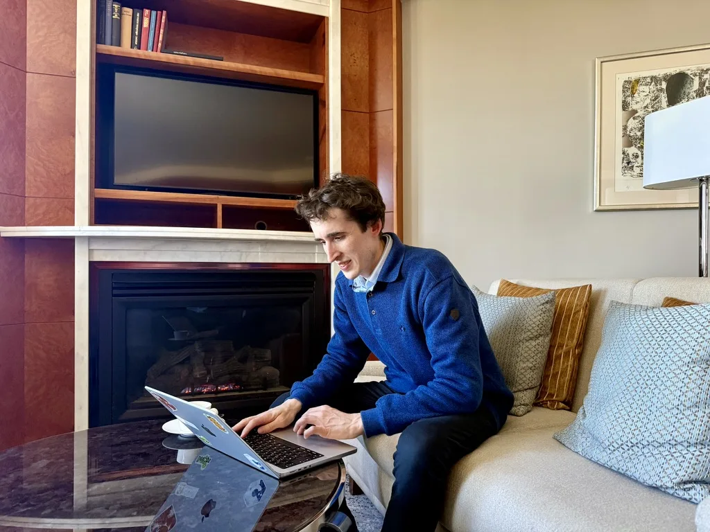

# PierreHenry.be

Personal website of **Pierre-Henry Soria**, a senior software engineer and technical consultant based in **Wellington, New Zealand**.

  

  
  
  
  
  
  
  
  

## About me

I'm a senior software engineer with 14 years of experience building and improving production software. My work spans full-stack product engineering, software architecture, complex integrations, reliability and practical AI. I've worked across healthcare, food technology, financial services and SaaS.

I work with founders, product teams and engineering leaders on focused consulting and contract engagements in New Zealand, Australia and remotely. I care about solving the right problem, making sound technical decisions and delivering software that can be maintained.

**Engineering focus:** TypeScript, Node.js, React, React Native, APIs, SQL, AWS, software architecture and AI engineering.

## Public work

- [pH7Builder](https://github.com/pH7Software/pH7-Social-Dating-CMS): long-running open-source community software.
- [ToucanDB](https://github.com/ToucanDB/ToucanDB): local-first vector database for search and retrieval.
- [pH7Console](https://github.com/EfficientTools/pH7Console): privacy-focused developer tooling with local AI.
- [SucceedAI](https://github.com/SucceedAI/macOS-Desktop-App): on-device AI writing assistant.

I also share engineering knowledge through my [technical blog](https://blog.pierrehenry.be/), [programming YouTube channel](https://www.youtube.com/@pH7Programming) and [Udemy courses](https://www.udemy.com/user/pierresoria/).

## Work with me

For freelance software engineering, consulting, technical leadership or AI integration work, see [my consulting services](https://www.pierrehenry.be/work-with-me.html) or [get in touch](mailto:pierre@pierrehenry.dev).
